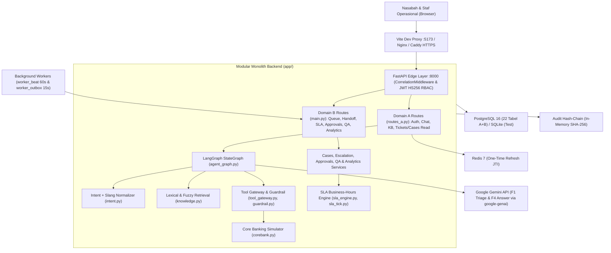
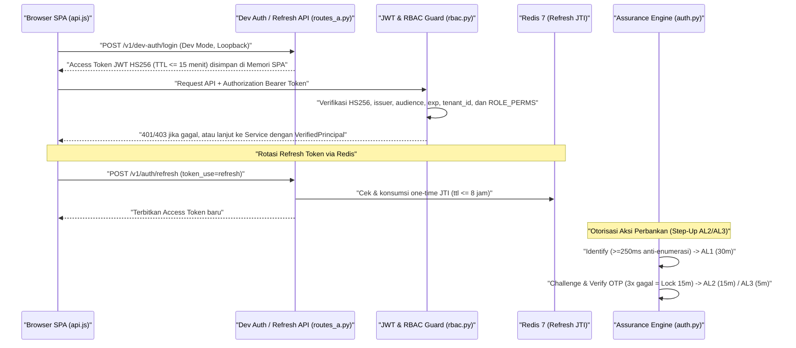
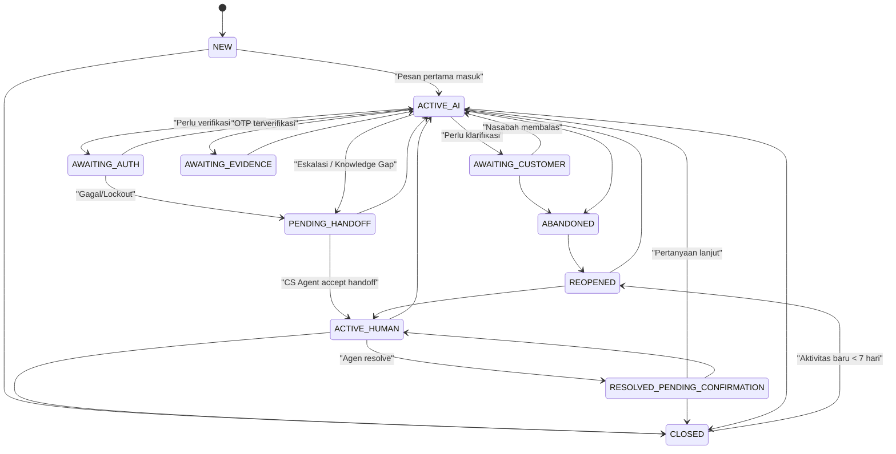
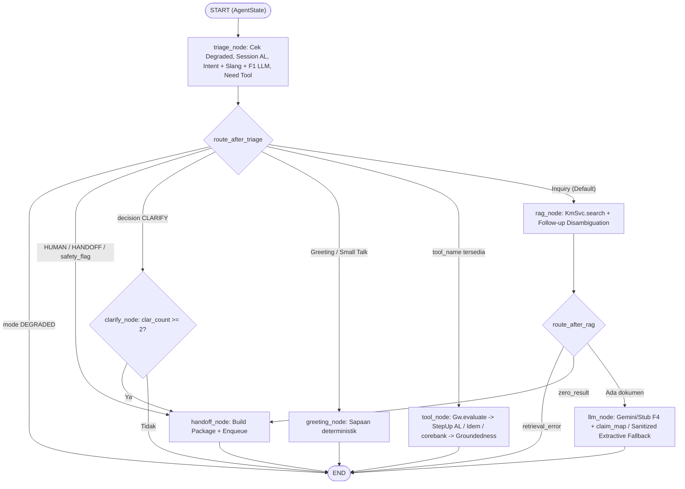
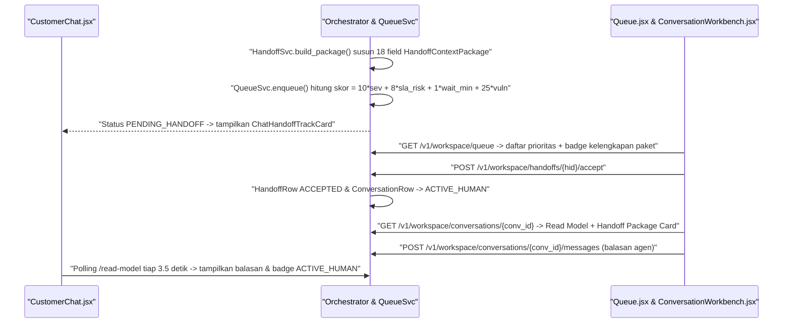
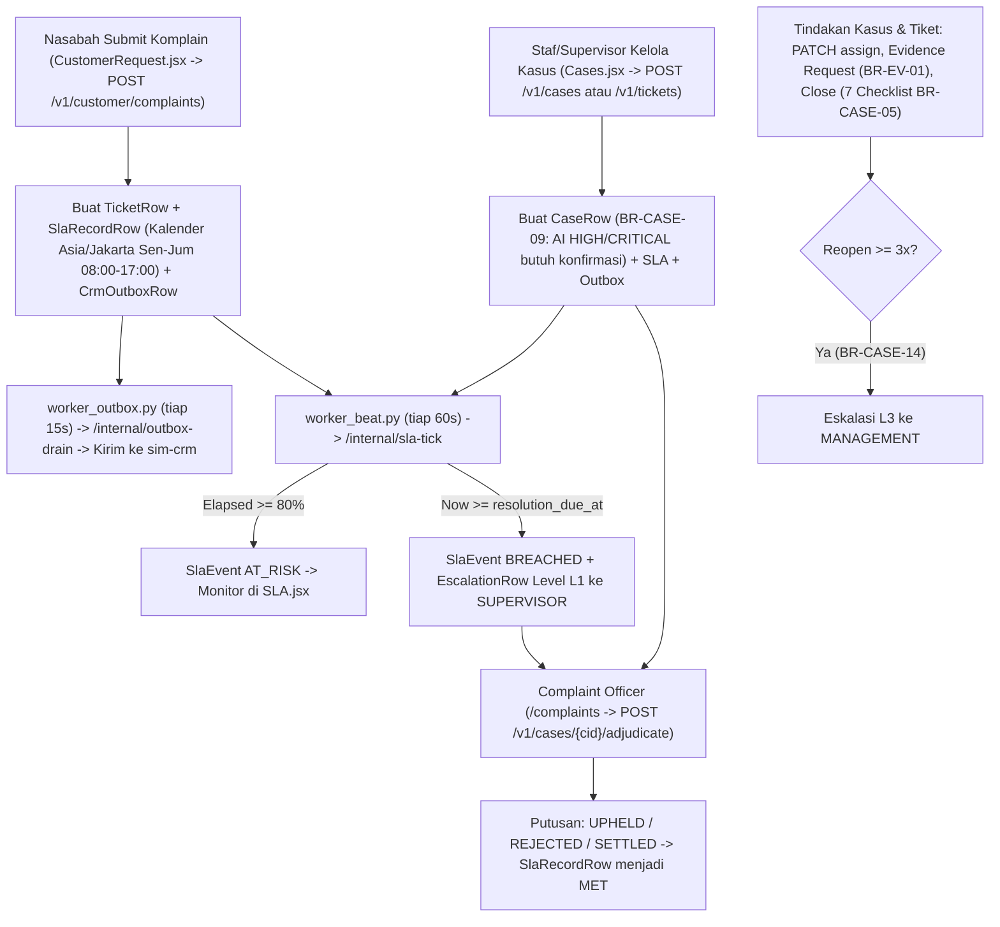

# Dokumentasi Teknologi, Arsitektur, & Alur Sistem EAICS

**EAICS (Enterprise Agentic AI Customer Service Platform)** adalah platform layanan pelanggan dan penyelesaian pengaduan (*complaint-resolution*) berbasis AI agentik untuk skenario layanan keuangan ritel sintetis (Nusantara Prima Bank / NEXORA). Sistem ini merupakan integrasi **Produk Bersama Kelompok A & Kelompok B** yang disusun berdasarkan spesifikasi **FRD-EAICS-001** dan **TRD-EAICS-001**.

---

## 1. Ringkasan Eksekutif & Status Sistem

* **Pola Arsitektur — Modular Monolith (`ADR-01`):**
  Seluruh backend berjalan dalam satu aplikasi terpadu **FastAPI + SQLAlchemy** di direktori `app/` yang melayani dua batas domain utama:
  * **Kelompok A (Customer Experience & Agentic AI):** Ingesti percakapan multi-kanal, mesin status percakapan, autentikasi/assurance bertingkat (AL0–AL3), klasifikasi intent & normalisasi slang, RAG Knowledge Base, orkestrasi LangGraph `StateGraph`, tool policy gateway, dan guardrail.
  * **Kelompok B (Operations, Cases, SLA & Governance):** Pembuatan tiket & kasus pengaduan, permintaan bukti, antrean alih tangan (*human handoff*), mesin perhitungan SLA jam kerja, eskalasi L1–L3, persetujuan bertingkat (*dual-custody*), QA review, analitik operasional, dan CRM outbox.
* **Antarmuka Pengguna (SPA):** Satu aplikasi Single-Page Application **React 18 + Vite 5** di direktori `web-workspace/` yang memisahkan secara tegas **Portal Pelanggan** (*Customer Portal*) dan **Ruang Kerja Staf** (*Staff Workspace*).
* **Status Implementasi Saat Ini:** **9 dari 17 Unit Roadmap telah selesai (Unit 01 – Unit 09)**. Unit 10 sampai Unit 17 masih berada dalam roadmap pengembangan berikutnya.

### Transparansi Status Komponen (Aktif vs Simulasi/Prototype)

Sesuai aturan tata kelola proyek (`context/ai-workflow-rules.md`), penting untuk membedakan komponen yang telah terhubung penuh dengan yang masih bersifat simulasi atau parsial:

| Status | Komponen & Keterangan Teknis |
| :--- | :--- |
| **Aktif Penuh (Persisten & Teruji)** | REST API FastAPI (`/v1/*`), autentikasi JWT HS256 + RBAC deny-by-default, LangGraph `StateGraph` 7 node, integrasi terstruktur Google Gemini (`google-genai`), ekstraksi/chunking dokumen PDF/DOCX/TXT, manajemen tiket/kasus/SLA/eskalasi/adjudikasi di DB SQLAlchemy, UI React SPA lengkap Unit 01–09. |
| **Mode Hybrid / Lokal Opt-in** | Login lokal dev (`/v1/dev-auth/*`) berbasis *fixed-account* dan JSON allowlist (`ENVIRONMENT=development`, *loopback-only*). Identity Provider (IdP) eksternal produksi belum terpasang. |
| **Simulasi / In-Memory Prototype** | **Core Banking Simulator** (`app/modules/corebank.py`) dengan data mock kartu/rekening; **CRM Outbox** (`app/modules/outbox.py` + `sim-crm`) sebagai simulator integrasi CRM; **Audit Trail Hash-Chain** (`app/core/audit.py`) dan challenge OTP/consent (`app/modules/auth.py`) masih tersimpan *in-memory* (belum persisten lintas restart proses). |
| **Belum Terhubung ke Alur Utama** | Retrieval RAG saat ini menggunakan **pencarian leksikal + fuzzy matching** (belum menggunakan vector embedding aktif); service **MinIO**, **Mailpit**, dan ekstensi **pgvector** sudah didefinisikan di `docker-compose.yml` beserta dependensi `requirements-full.txt`, namun belum diaktifkan pada alur utama aplikasi. |

---

## 2. Teknologi & Tech Stack yang Dipakai

### 2.1 Backend & HTTP API Layer

| Komponen | Teknologi & Versi (Manifest / Terpasang) | Lokasi File Utama | Fungsi Utama |
| :--- | :--- | :--- | :--- |
| **Bahasa & Runtime** | Python (`3.12-slim` di Docker; 3.10+ di lingkungan lokal) | `Dockerfile`, `app/` | Runtime utama backend monolith dan worker. |
| **Web Framework** | FastAPI (`fastapi`, terpasang `0.141.1`) | `app/main.py`, `app/modules/routes_a.py` | Mendefinisikan endpoint REST (`/v1/*`, `/internal/*`, `/healthz`, `/readyz`) & dokumentasi OpenAPI (`/docs`). |
| **ASGI Server** | Uvicorn (`uvicorn[standard]`, terpasang `0.52.4`) | `Dockerfile`, `start-local.ps1` | Server HTTP asinkron pada port `8000`. |
| **Validasi Data** | Pydantic v2 (`pydantic`, terpasang `2.13.5`) | `app/modules/llm_provider.py`, `app/modules/cases.py` | Validasi skema request/response API serta kontrak skema JSON terstruktur LLM F1–F4. |
| **Middleware HTTP** | Starlette `BaseHTTPMiddleware` & `CORSMiddleware` | `app/core/correlation.py`, `app/main.py` | Propagasi `X-Correlation-Id` lintas request (`FR-SEC-005`) dan kebijakan CORS terkontrol. |
| **Upload File** | `python-multipart` (`0.0.18`) | `app/modules/routes_a.py` | Parsing unggahan dokumen multipart (`PDF`, `DOCX`, `TXT`) ke Knowledge Base. |

### 2.2 Agentic AI, Orchestration, & NLP/RAG Layer

| Komponen | Teknologi & Versi | Lokasi File Utama | Fungsi Utama |
| :--- | :--- | :--- | :--- |
| **Orkestrasi Agentik** | LangGraph (`1.2.20`) + `langchain-core` (`1.7.6`) | `app/modules/agent_graph.py`, `app/modules/orchestrator.py` | Menjalankan alur keputusan `StateGraph(AgentState)` dengan 7 node (`triage_node`, `clarify_node`, `greeting_node`, `tool_node`, `rag_node`, `llm_node`, `handoff_node`). |
| **LLM Provider SDK** | Google GenAI SDK (`google-genai==2.31.0`) | `app/modules/gemini_provider.py`, `app/modules/llm_provider.py` | Eksekusi structured JSON generation (F1 & F4) melalui `GeminiStructuredGenerationProvider` (timeout maks `20000 ms`, `attempts=1`). Default di `.env.example` adalah `stub` (`DeterministicStubProvider`). |
| **Normalisasi Slang & Typo Indonesia** | Rule-based `SLANG_MAP`, `difflib.SequenceMatcher`, & Dynamic Gemini F1 Semantic Triage | `app/modules/intent.py`, `app/modules/agent_graph.py`, `app/modules/knowledge.py` | Menangani singkatan, bahasa santai, & salah ketik Bahasa Indonesia; jika confidence rule `< 0.75`, memanggil Gemini F1 untuk analisis semantik dinamis; pencarian knowledge mendukung fuzzy similarity rasio `>= 0.82`. |
| **Ekstraksi Dokumen** | `pypdf` (`6.19.0`), `zipfile` + `xml.etree.ElementTree` (stdlib), UTF-8 | `app/modules/knowledge.py` | Ekstraksi teks dari PDF, DOCX (`word/document.xml`), dan TXT dengan validasi *magic bytes* MIME, batas ukuran `10 MB`, `chunk_size=1000`, `overlap=200`, maks `500 chunk/dokumen`. |
| **Policy & Tool Gateway** | Custom Registry, SHA-256 Idempotency, & Circuit Breaker | `app/modules/tool_gateway.py` | Mengatur 18 tool berversi (`AL0`–`AL2`), memblokir 11 `PROHIBITED` tools, menerapkan circuit breaker 30 detik, dan mencegah eksekusi ganda. |
| **Guardrail AI** | Regex Engine & Numerical Claim Verifier | `app/modules/guardrail.py` | Deteksi 8 famili *prompt injection*, validasi angka/klaim faktual terhadap sumber (*groundedness*), pencegahan klaim eksekusi palsu (*action-state check*), & blokir kebocoran PII/ambang internal. |

### 2.3 Database, Cache, & Penyimpanan

| Komponen | Teknologi & Versi | Lokasi File Utama | Fungsi Utama |
| :--- | :--- | :--- | :--- |
| **Database Utama** | PostgreSQL 16 (`pgvector/pgvector:pg16` di Compose) | `docker-compose.yml`, `app/core/db.py` | Penyimpanan relasional transaksional (22 tabel untuk domain A & B). Ekstensi pgvector tersedia di image untuk fase vector RAG lanjutan. |
| **ORM & Driver DB** | SQLAlchemy (`2.0.55`) + `psycopg[binary]` (`3.3.6`) | `app/core/db.py`, `app/modules/models.py`, `app/modules/models_a.py` | Pemodelan tabel deklaratif dan manajemen `SessionLocal`. |
| **Database Pengujian** | SQLite | `tests/conftest.py`, `app/core/db.py` | Digunakan secara eksplisit untuk rangkaian unit/integration test (`DATABASE_URL=sqlite:///...`). |
| **Migrasi Skema** | Alembic (`alembic.ini`) | `alembic/versions/0001_init_b.py`, `0002_knowledge_documents.py` | Skrip migrasi skema; saat startup lokal, `app/main.py` masih mengeksekusi `Base.metadata.create_all()`. |
| **Cache / Token Store** | Redis 7 (`redis:7-alpine`, client `redis==5.0.8`) | `docker-compose.yml`, `app/modules/routes_a.py` | Konsumsi `jti` sekali pakai (*one-time refresh token rotation*). |
| **Object Storage & Mail** | MinIO & Mailpit | `docker-compose.yml` | Disiapkan pada profil Docker penuh (belum terhubung ke alur produksi unggahan lampiran atau notifikasi email). |

### 2.4 Keamanan, Autentikasi, & Audit

| Komponen | Teknologi & Mekanisme | Lokasi File Utama | Fungsi Utama |
| :--- | :--- | :--- | :--- |
| **JWT & Kriptografi** | `python-jose[cryptography]==3.3.0` + `hmac.compare_digest` | `app/core/rbac.py`, `app/core/dev_auth.py` | Validasi Bearer JWT `HS256`: human access token (`<= 900s` / 15 mnt), refresh token (`<= 8 jam`), service token (`<= 300s` / 5 mnt). |
| **RBAC Policy** | Deny-by-Default Role Permission Matrix (9 Role) | `app/core/rbac.py` | Memastikan setiap endpoint hanya dapat diakses oleh peran dan izin yang tepat serta terisolasi oleh `tenant_id`. |
| **Assurance Bertingkat** | Session Assurance Engine (`AL0`–`AL3`) | `app/modules/auth.py` | Pengaturan masa berlaku sesi (AL1 30m, AL2 15m, AL3 5m), perlindungan *anti-enumeration* (`>= 250ms`), lockout 3x gagal (15 mnt), dan pencatatan *consent*. |
| **Identitas & Audit** | Prefixed ULID 26-karakter & Hash-Chain Audit | `app/core/ids.py`, `app/core/audit.py`, `app/core/masking.py` | Penomoran objek standar (`CNV-`, `TKT-`, `CAS-`, `HDO-`, dll.), kode referensi nasabah (`C-XXXX-NN` / `T-XXXX-NN`), serta rantai audit 22-field dengan SHA-256 (*in-memory*). |

### 2.5 Frontend / Web Workspace

| Komponen | Teknologi & Versi | Lokasi File Utama | Fungsi Utama |
| :--- | :--- | :--- | :--- |
| **UI Library** | React (`^18.3.1`) & React DOM (`^18.3.1`) | `web-workspace/package.json`, `web-workspace/src/` | Antarmuka Portal Pelanggan & Ruang Kerja Staf (JavaScript/JSX murni tanpa UI kit eksternal). |
| **Build Tool & Proxy** | Vite (`^5.4.0`) + `@vitejs/plugin-react` (`^4.3.1`) | `web-workspace/vite.config.js` | Server dev port `5173` dengan proxy `/v1`, `/internal`, `/healthz`, `/readyz` ke backend `:8000` serta bundling produksi (`dist/`). |
| **Routing & Auth State** | HTML5 History API + Memory-Only Token Provider | `web-workspace/src/App.jsx`, `api.js`, `routes.js`, `shared/navigation.js`, `workspace-access.js` | Navigasi SPA berbasis role tanpa meletakkan token JWT di `localStorage`/`sessionStorage`. |
| **Styling System** | CSS Modular (Custom Properties & Responsive Design) | `web-workspace/src/app.css`, `web-workspace/src/styles/*.css` | Token warna terstruktur di `shell.css`, `customer.css`, `chat.css`, `workspace.css`, dan `knowledge.css`. |

### 2.6 Background Workers, Infrastruktur, Deployment, & Pengujian

| Komponen | Teknologi & File Terkait | Lokasi File Utama | Fungsi Utama |
| :--- | :--- | :--- | :--- |
| **Background Workers** | Python HTTP Poll Loops + Service JWT (`HS256`) | `app/worker_beat.py`, `app/worker_outbox.py` | Memicu `/internal/sla-tick` setiap **60 detik** (`sla-beat`) dan `/internal/outbox-drain` setiap **15 detik** (`outbox-worker`). |
| **Container & Cloud** | Docker Compose, Caddy 2, Nginx, Vercel | `Dockerfile`, `docker-compose*.yml`, `Caddyfile`, `nginx.conf`, `vercel.json` | Caddy menyediakan HTTPS otomatis + gerbang `basic_auth`; Nginx & Vercel menyediakan SPA fallback + *security headers* (CSP, `X-Frame-Options: DENY`). |
| **Testing & Otomasi** | `pytest` (`9.1.1`), `httpx` (`0.28.1`), Node `node --test`, PowerShell | `tests/`, `web-workspace/tests/`, `scripts/smoke_e2e.py`, `synthetic/run.py`, `start-local.ps1` | 15 modul pengujian backend, 2 suite pengujian frontend, generator data sintetis deterministik (`seed=42`), dan skrip startup lokal Windows. |
| **Dependensi Profil Penuh (Opsional/Roadmap)** | `celery[redis]`, `structlog`, `opentelemetry`, `prometheus-client`, `boto3`, `passlib`, `scikit-learn`, `sentence-transformers`, `testcontainers` | `requirements-full.txt` | Didefinisikan untuk profil Docker/staging penuh di unit lanjutan (observability, embedding ML, antrean terdistribusi). |

---

## 3. Arsitektur Tingkat Tinggi, Struktur Direktori, Skema DB, & RBAC

### 3.1 Diagram Arsitektur Sistem

### 3.2 Peta Struktur Direktori Utama

* `app/core/` — Utilitas lintas modul: koneksi DB (`db.py`), autentikasi & RBAC (`rbac.py`, `dev_auth.py`), middleware korelasi (`correlation.py`), format error (`errors.py`), ULID & short-ref (`ids.py`), audit hash-chain (`audit.py`), dan masking (`masking.py`).
* `app/contracts/` — Kosakata status dan enum terkunci sesuai TRD §16.2 (`vocabularies.py`).
* `app/modules/` — Logika domain A+B dan definisi tabel SQLAlchemy (`models_a.py`, `models.py`).
* `web-workspace/src/` — Kode sumber React SPA yang dipisah ke `pages/customer/`, `pages/workspace/`, `shared/`, dan `styles/`.
* `alembic/` — Konfigurasi dan skrip migrasi database PostgreSQL.
* `tests/` & `web-workspace/tests/` — Rangkaian pengujian otomatis backend & frontend.
* `scripts/` & `synthetic/` — Verifikasi E2E (`smoke_e2e.py`), pengecekan kontrak UI (`check_ui_contract.py`), migrasi data, dan generator data sintetis (`run.py`).
* `context/` & `docs/` — Dokumentasi spesifikasi tiap unit (`context/specs/`), laporan audit, diagram desain (`system-design-diagrams.html`), dan panduan.

### 3.3 Inventaris Skema Database (22 Tabel)

| Kelompok & Sumber | Daftar Tabel | Cakupan Data |
| :--- | :--- | :--- |
| **Kelompok A** (`app/modules/models_a.py` — 11 Tabel) | `conversation`, `channel_session`, `message`, `customer_chat_request`, `intent_classification`, `knowledge_article`, `article_version`, `knowledge_document`, `knowledge_chunk`, `tool_call`, `policy_decision` | Identitas percakapan lintas kanal, sesi AL0–AL3, transkrip pesan + sitasi, idempotensi chat nasabah, hasil klasifikasi intent, artikel & dokumen unggahan KB beserta chunk teksnya, serta log keputusan kebijakan & pemanggilan tool. |
| **Kelompok B** (`app/modules/models.py` — 11 Tabel) | `ticket`, `case_tbl`, `sla_record`, `sla_event`, `crm_outbox`, `escalation`, `approval`, `handoff`, `qa_sample`, `qa_review`, `qa_finding` | Tiket layanan & kasus pengaduan nasabah, target SLA & log kejadian `AT_RISK`/`BREACHED`, antrean sinkronisasi CRM (`crm_outbox`), eskalasi L1–L3, snapshot persetujuan *dual-custody*, antrean alih tangan (*handoff*), serta sampling & temuan QA. |

### 3.4 Matriks Peran RBAC & Akses UI (`app/core/rbac.py` & `workspace-access.js`)

| Role | Izin Utama Backend (`ROLE_PERMS`) | Akses Halaman Frontend (`web-workspace`) |
| :--- | :--- | :--- |
| `customer` | `conversation.read/write`, `ticket.read`, `case.read`, `evidence.upload`, `feedback.submit`, `handoff.initiate` | Portal Publik & Customer (`/customer/chat`, `/customer/requests/new`, `/customer/requests`, `/customer/conversations`, `/customer/account`) |
| `ai_agent` | `conversation.read/write`, `knowledge.read`, `tool.invoke`, `ticket.create/read`, `case.create/read`, `evidence.request`, `sla.read`, `handoff.initiate` | Identitas layanan backend (*service token*); tidak memiliki UI login staf. |
| `cs_agent` | Izin percakapan, `knowledge.read`, `knowledge.document.ingest`, `tool.invoke`, `ticket.*`, `case.*` (tanpa close), `evidence.request`, `handoff.accept/initiate`, `sla.read` | `/agent/queue`, `/agent/conversations`, `/agent/cases`, `/knowledge` |
| `supervisor` | Seluruh izin operasional CS + `case.close`, `sla.override`, `escalation.resolve`, `tool.invoke_write_sensitive`, `audit.read`, `analytics.read` | `/supervisor`, `/supervisor/queue`, `/supervisor/cases`, `/complaints`, `/supervisor/approvals`, `/supervisor/sla`, `/supervisor/audit`, `/knowledge` |
| `complaint_officer` | `ticket.read/update`, `case.read/update/close`, `evidence.adjudicate`, `sla.read`, `knowledge.read/document.ingest` | `/complaints`, `/knowledge` |
| `qa_analyst` | `qa.review`, `case.read`, `knowledge.read/document.ingest` | `/qa`, `/knowledge` |
| `knowledge_manager` | `knowledge.read`, `knowledge.write`, `knowledge.document.ingest` | `/knowledge` |
| `management` | `analytics.read`, `knowledge.read/document.ingest` (agregat, tanpa konten percakapan mentah) | `/management`, `/knowledge` |
| `admin` | `tool.registry_manage`, `user.manage`, `config.manage`, `knowledge.read/document.ingest` (**RBAC-05:** dilarang akses isi percakapan/PII) | `/admin`, `/knowledge` |

---

## 4. Alur Kerja Sistem (End-to-End System Flows)

### 4.1 Alur Autentikasi, RBAC, & Step-Up Assurance (AL0–AL3)

Sistem memisahkan **autentikasi identitas endpoint** (JWT Bearer HS256 oleh `app/core/rbac.py`) dan **tingkat keyakinan sesi percakapan** (`AL0` s.d. `AL3` oleh `app/modules/auth.py`).

1. **Token Akses & Pemisahan Peran:** Di mode pengembangan lokal (`ENVIRONMENT=development`), login dilakukan dari *loopback* via `/v1/dev-auth/customer/login`, `/v1/dev-auth/staff/login`, atau `/v1/dev-auth/login`. Token disimpan hanya di memori JavaScript (`web-workspace/src/api.js`), bukan di web storage.
2. **Service-to-Service Token:** Worker (`sla-beat`, `outbox-worker`) dan `orchestrator` menggunakan key khusus per-service (`SERVICE_TOKEN_KEYS`) dengan masa berlaku maksimal `300 detik`, di mana izin efektif adalah irisan antara role dan scope allowlist.
3. **Assurance Level Sesi (`auth.py`):** Operasi dasar informasi publik cukup `AL0`; akses saldo, mutasi, atau blokir kartu sementara membutuhkan `AL2` (berlaku 15 menit); aksi sensitif seperti ubah limit, ubah profil, atau laporan fraud membutuhkan `AL3` (berlaku 5 menit). Jika masa berlaku habis (`check_session`), status turun ke `AL0` tanpa menghapus riwayat percakapan.

### 4.2 Alur Ingesti Pesan & Mesin Status Percakapan

1. **Idempotensi Ganda:** Endpoint `POST /v1/chat/messages` memeriksa tabel `customer_chat_request` menggunakan header `Idempotency-Key` + hash payload per `tenant_id` & `actor_id`. Pada lapisan ingesti kanal (`conversation.ingest`), `provider_message_id` per kanal juga dide-duplikasi secara terisolasi per tenant agar tidak membocorkan percakapan tenant lain.
2. **Kontinuitas 72 Jam & Reopen 7 Hari:** Jika nasabah mengirim pesan tanpa `conversation_id` dan `force_new=false`, sistem mencari percakapan terbuka milik nasabah yang aktif dalam 72 jam terakhir (`CONTINUITY_H = 72`), atau membuka kembali (`REOPENED`) percakapan `CLOSED` dalam 7 hari terakhir (`REOPEN_D = 7`).

### 4.3 Alur Agentic AI Decision Loop (LangGraph `StateGraph`)

Setelah pesan tersimpan oleh `conversation.ingest`, `orchestrator.run_turn()` mendelegasikan pemrosesan ke `run_turn_langgraph()` di `app/modules/agent_graph.py`:

Penjelasan langkah setiap node:
1. **`triage_node`:** Memeriksa status `DEGRADED`, mengevaluasi *Assurance Level* sesi, lalu mengklasifikasikan maksud pesan melalui `IntentSvc.classify` (`SLANG_MAP` normalisasi singkatan + aturan keyword). Jika confidence rendah (`< 0.75`) atau belum terklasifikasi (`OTHER_UNCLASSIFIED`) serta bukan permintaan petugas/aksi terlarang, sistem memanggil **Gemini F1 Semantic Triage** untuk memahami slang atau typo baru secara dinamis. Hasil disimpan ke `intent_classification` dan slot dicek lewat `_need_tool`.
2. **`route_after_triage`:** Mengarahkan eksekusi ke salah satu cabang: `handoff_node` (permintaan bicara dengan manusia, `CMP_FRAUD_SUSPICION`, `CMP_STAFF_CONDUCT`, atau aksi refund/reversal yang harus ditangani petugas), `clarify_node`, `greeting_node`, `tool_node`, atau `rag_node`.
3. **`clarify_node`:** Mengajukan pertanyaan klarifikasi spesifik dan membatasi klarifikasi maksimal **2 kali** (`clar_count >= 2`) sebelum memaksa alih tangan ke `handoff_node` (`TRD §8.2`).
4. **`tool_node`:** Mengevaluasi kebijakan lewat `tool_gateway.evaluate()`. Jika kurang level keamanan (`STEP_UP_REQUIRED`), percakapan berpindah ke `AWAITING_AUTH`. Jika lolos (`ALLOW`), mengecek cache idempotensi, menjalankan simulator (`corebank.py` / `Store`), dan memvalidasi angka output lewat `guardrail.groundedness()`.
5. **`rag_node`:** Memanggil `KmSvc.search()` berdasarkan teks saat ini. Jika pertanyaan berupa rujukan singkat (*"maksudnya?"*, *"lebih lanjut"*) dan hasil nol, ia mengambil pertanyaan nasabah sebelumnya untuk pencarian. Jika tetap nol (`zero_result`), diarahkan ke `handoff_node` dengan alasan `KNOWLEDGE_GAP`.
6. **`llm_node`:** Mengirim potongan teks terverifikasi ke provider F4 (Gemini/Stub) untuk menghasilkan jawaban berbahasa Indonesia alami yang wajib memiliki `claim_map` terikat ke `source_id`. Jika provider error/timeout, blok **`EXTRACTIVE_FALLBACK`** merapikan kutipan dokumen via `_reflow_document_text` (membersihkan header mentah seperti `.pdf` atau kode file) serta memblokir dokumen panduan internal agar tidak bocor ke nasabah.
7. **`handoff_node`:** Menyusun `HandoffContextPackage` dan memasukkan sesi ke antrean petugas (`QueueSvc.enqueue`).

### 4.4 Alur Knowledge Base Ingestion & Retrieval (RAG)

```mermaid
flowchart LR
    Upload["Staf Upload PDF/DOCX/TXT atau Teks Langsung (KnowledgeManager.jsx)"] --> Validate["Validasi Ukuran <= 10MB, Ekstensi, Magic Bytes MIME, & SHA-256"]
    Validate --> Extract["Ekstraksi Teks (pypdf / XML DOCX / UTF-8)"]
    Extract --> Chunk["Chunking: 1000 char, Overlap 200 char, Maks 500 Chunk"]
    Chunk --> DB["Simpan knowledge_document (status ready) & knowledge_chunk"]
    DB --> Search["KmSvc.search: Query Stopwords + Slang Normalization + Fuzzy Ratio >= 0.82"]
    Search --> Filter["Filter Dokumen Internal (hr_policy, panduan_sapaan, cara_kerja_chatbot)"]
    Filter --> Top["Ambil Top 5 Sumber + Sitasi -> llm_node -> CustomerChat"]
```

1. **Akses & Isolasi:** Seluruh 7 peran staf memiliki izin `knowledge.read` dan `knowledge.document.ingest`, sedangkan authoring artikel versi terkelola (`POST /v1/knowledge/articles`) khusus untuk `knowledge_manager`.
2. **Keamanan Konten:** Pencarian untuk nasabah (`for_agent=False`) secara aktif menyaring dokumen internal/HR/panduan prompt bot agar tidak pernah muncul sebagai jawaban atau sitasi di sisi nasabah.

### 4.5 Alur Human Handoff, Antrean Prioritas, & Workbench CS Agent

* Jika CS Agent perlu memindahkan ke antrean lain (`POST /v1/workspace/handoffs/{hid}/transfer`), sistem mewajibkan catatan serah terima (`BR-WS-04`).
* Penutupan percakapan oleh agen (`POST /v1/workspace/conversations/{conv_id}/resolve`) mengubah status menjadi `RESOLVED_PENDING_CONFIRMATION`.

### 4.6 Alur Pengaduan, Tiket, Kasus, SLA, Eskalasi, & Adjudikasi (Unit 06–09)

### 4.7 Alur Approval Dual-Custody, QA, & Audit Trail

1. **Dual-Custody Approvals (`app/modules/approvals.py` & `Approvals.jsx`):**
   * Permintaan persetujuan (`POST /v1/approvals`) menyimpan `arguments_snapshot` dan hash SHA-256 (`arguments_hash`) dengan masa kedaluwarsa **4 jam**.
   * Aturan `RBAC-02` memblokir *self-approval* (`requested_by == approver_id` ditolak). Saat eksekusi (`check_hash_for_execution`), argumen di-hash ulang untuk memverifikasi integritas (`BR-ORC-07`) agar parameter tidak berubah setelah disetujui. *(Antarmuka & batas eksekusi terpadu akan diperkuat lebih lanjut di Unit 10).*
2. **Quality Assurance (`app/modules/qa.py`, `qa_db.py`, & `QA.jsx`):**
   * Mendukung sampling otomatis (`10% random + 100% high-risk` dengan seed deterministik), pencatatan skor rubrik + flag *auto-fail*, serta pencatatan temuan (`knowledge_gap`, `ai_defect`, `process_defect`). *(Workbench evaluasi penuh dijadwalkan di Unit 12).*
3. **Audit Trail (`app/core/audit.py` & `Audit.jsx`):**
   * Setiap kejadian kritis memancarkan event audit 22-field berantai SHA-256 (`previous_hash` -> `record_hash`) per `tenant_id` yang dapat ditelusuri utuh berdasarkan `correlation_id` via `GET /v1/audit/trail/{correlation_id}`.

---

## 5. Inventaris Ringkas Endpoint REST API

Seluruh endpoint terdaftar pada satu instance FastAPI (`app/main.py` & `app/modules/routes_a.py`):

| Kelompok API | Endpoint Utama | Keterangan |
| :--- | :--- | :--- |
| **Health & Probe** | `GET /`, `GET /healthz`, `GET /readyz` | Pemeriksaan status hidup API dan koneksi database PostgreSQL/SQLite. |
| **Auth Lokal & Token** | `POST /v1/dev-auth/customer/login`, `/v1/dev-auth/staff/login`, `/v1/dev-auth/login`, `/v1/auth/refresh` | Login dev (loopback & development only) serta rotasi refresh token via Redis. |
| **Channel & Chat Nasabah** | `POST /v1/channels/{channel}/inbound`, `POST /v1/chat/messages`, `GET /v1/customer/conversations`, `GET /v1/conversations/{conv_id}/read-model` | Penerimaan pesan, orkestrasi LangGraph, daftar riwayat milik nasabah, dan transkrip percakapan ber-cursor. |
| **Komplain Nasabah & Status Publik** | `POST /v1/customer/complaints`, `GET /v1/customer/complaints`, `GET /v1/status/{reference}` | Pengajuan pengaduan resmi nasabah, pelacakan SLA pribadi, dan lookup status publik tersanitasi. |
| **Assurance AL0–AL3** | `POST /v1/auth/identify`, `/v1/auth/challenge`, `/v1/auth/verify`, `/v1/auth/consent` | Identifikasi, OTP challenge/verify untuk step-up ke AL2/AL3, dan pencatatan persetujuan. |
| **Knowledge Base** | `POST /v1/knowledge/articles`, `GET /v1/knowledge/search`, `POST/GET/PUT/PATCH/DELETE /v1/knowledge/documents*`, `.../retry`, `.../replace` | Manajemen artikel berversi, upload & ekstraksi dokumen, pembaruan isi/re-chunking, serta pencarian RAG. |
| **Tools Gateway** | `GET /v1/tools/registry`, `POST /v1/tools/invoke`, `POST /internal/sim-profile` | Daftar tool terdaftar, eksekusi terkontrol kebijakan, dan pengaturan profil simulator chaos test. |
| **Tickets, Cases & Evidence** | `GET/POST /v1/tickets`, `GET/PATCH /v1/tickets/{tid}`, `PATCH /v1/tickets/{tid}/assign`, `GET/POST/PATCH /v1/cases*`, `POST /v1/cases/{id}/close`, `.../reopen`, `.../evidence-requests`, `.../adjudicate`, `POST /v1/evidence/upload-link` | Siklus hidup lengkap tiket, kasus, alih antrean spesialis, checklist penutupan, permintaan bukti, dan adjudikasi sengketa. |
| **Queue, Handoff & Workbench** | `POST /v1/workspace/queue/enqueue`, `GET /v1/workspace/queue`, `POST /v1/workspace/handoffs/{hid}/accept`, `.../transfer`, `GET /v1/workspace/conversations/{id}`, `POST .../messages`, `.../resolve` | Manajemen antrean agen CS, read model lengkap dengan 18-field *handoff package*, balasan agen, dan resolusi percakapan. |
| **SLA & Eskalasi** | `POST /v1/sla/calculate`, `GET /v1/workspace/sla/records`, `GET /v1/workspace/escalations`, `POST /v1/workspace/escalations/{eid}/acknowledge` | Perhitungan SLA jam kerja Jakarta, pemantauan risiko SLA, dan pengakuan eskalasi supervisor/officer. |
| **Approvals, QA, Analytics & Audit** | `GET/POST /v1/approvals*`, `POST /v1/approvals/{aid}/decide`, `POST /v1/qa/sample`, `.../reviews`, `.../findings`, `GET /v1/analytics/*`, `POST /v1/copilot/suggest`, `GET /v1/audit/trail/{correlation_id}` | Persetujuan *dual-custody*, sampling & review QA, metrik operasional & ekspor CSV, serta penelusuran jejak audit. |
| **Internal Workers** | `POST /internal/sla-tick`, `GET /internal/outbox-status`, `POST /internal/outbox-drain` | Endpoint internal yang dipanggil oleh `worker_beat.py` dan `worker_outbox.py` dengan service token. |

---

## 6. Roadmap Unit Pengembangan (01–17) & Batasan Teknis

### 6.1 Peta Kemajuan Roadmap (`context/specs/00-build-plan.md`)

* **Telah Selesai (Unit 01 – 09):**
  1. **Unit 01:** Audit repositori & requirements traceability.
  2. **Unit 02:** Authenticated Principal (JWT HS256), RBAC deny-by-default, & isolasi tenant/owner.
  3. **Unit 03:** Route shell berbasis role & pemisahan UI Customer vs Staff.
  4. **Unit 04:** API percakapan & riwayat nasabah (idempotensi & dev auth).
  5. **Unit 05:** Portal percakapan informasi nasabah, RAG + sitasi, & integrasi LangGraph.
  6. **Unit 06:** API pengaduan & kepemilikan tiket nasabah.
  7. **Unit 07:** UI pengajuan pengaduan, pelacakan SLA, & akun pelanggan.
  8. **Unit 08:** Agent Workspace Read Model (18-field *Handoff Context Package*) & Queue terperkaya.
  9. **Unit 09:** Operasional Supervisor & Complaint Officer (eskalasi, monitor risiko SLA, reassign tiket, adjudikasi kasus).
* **Tersisa dalam Antrean (Unit 10 – 17):**
  * **Unit 10:** Approval Workflow UI & batas eksekusi *dual-custody* yang tahan uji.
  * **Unit 11:** Knowledge Lifecycle penuh (transisi status review/publish/expiry) & penyempurnaan Manager Workspace.
  * **Unit 12:** QA Review Workspace & Evaluation Provenance.
  * **Unit 13:** Management Metrics & Executive Reporting (definisi metrik & denominator persisten).
  * **Unit 14:** Administration & Audit Workspace terpisah dari operasional harian.
  * **Unit 15:** Durable Integrations, Object Storage (MinIO/S3), Notification Adapter, & Background Workers produksi.
  * **Unit 16:** Startup, Alembic Migration Lifecycle, Dependency Pinning, & Observability Hardening.
  * **Unit 17:** End-to-End Role, WCAG Accessibility, & Release Verification.

### 6.2 Batasan Sistem Saat Ini

1. **Identity Provider Produksi:** Belum ada IdP eksternal atau manajemen pendaftaran akun nasabah/staf nyata; login saat ini menggunakan mekanisme opt-in khusus pengembangan lokal.
2. **Ketahanan Audit & State Challenge:** Audit log (`audit.py`), challenge OTP & consent (`auth.py`), serta circuit breaker tool (`tool_gateway.py`) masih disimpan di memori proses Python dan tidak bertahan jika server di-restart.
3. **Skema Multi-Tenant & Migrasi:** Sebagian tabel Kelompok B (seperti `approval`, `escalation`, `crm_outbox`, `qa_*`) belum memiliki kolom `tenant_id` langsung dan bergantung pada join ke tabel induk; startup `app/main.py` masih memanggil `Base.metadata.create_all()` alih-alih menjalankan migrasi Alembic sepenuhnya.
4. **Vector RAG & Integrasi Eksternal:** Retrieval pengetahuan belum menggunakan vector embedding/pgvector; penyimpanan lampiran MinIO, email Mailpit, serta integrasi core banking/CRM masih berupa simulator atau stub.
